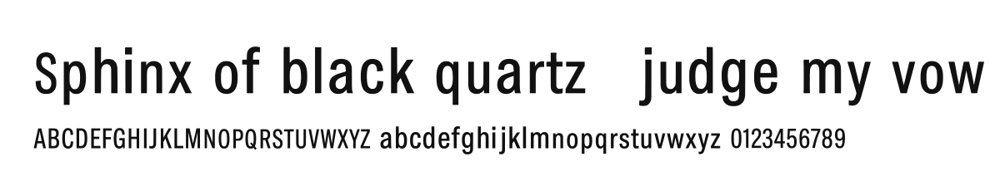

# Artifisio Fonts

**[Browse the gallery → artifisio.github.io/fonts](https://artifisio.github.io/fonts/)**

13 open-licensed font families. Type your own text, check glyph coverage, then install a family with one command.

## Featured

<table>
<tr>
<td align="center" valign="top" width="100%">
<a href="sets/multi-sans"></a>
<br /><br />
<strong><a href="sets/multi-sans">Multi Sans</a></strong><br />
<sub>1 style · latin · OTF · WOFF2</sub><br /><br />
<code>npx artifisio add multi-sans --kind font</code>
</td>
</tr>
</table>

## All sets (13)

| Set | Slug | Details | Tags |
| --- | ---- | ------- | ---- |
| [Multi Sans](sets/multi-sans) | `multi-sans` | 1 style · latin · OTF · WOFF2 | sans, condensed, grotesque, display, headline |
| [Kreisform](sets/kreisform) | `kreisform` | 1 style · latin · OTF · WOFF2 | display, bauhaus, geometric |
| [Prism Cut](sets/prism-cut) | `prism-cut` | 1 style · latin · OTF · WOFF2 | display, geometric, faceted |
| [Ivywork](sets/ivywork) | `ivywork` | 1 style · latin · OTF · WOFF2 | display, art-nouveau, botanical |
| [Ironfraktur](sets/ironfraktur) | `ironfraktur` | 1 style · latin · OTF · WOFF2 | blackletter, display, brutalist |
| [Asteria](sets/asteria) | `asteria` | 1 style · latin · OTF · WOFF2 | sans, geometric, minimal |
| [Vellum Display](sets/vellum-display) | `vellum-display` | 1 style · latin · OTF · WOFF2 | serif, didone, display |
| [Circuit font](sets/circuit-font) | `circuit-font` | 1 style · latin · OTF · WOFF2 |  |
| [Atrium Flare](sets/atrium-flare) | `atrium-flare` | 2 styles · latin · OTF · WOFF2 | sans, flare, display |
| [Inkstick](sets/inkstick) | `inkstick` | 2 styles · latin · OTF · WOFF2 | handwritten, marker, casual |
| [Fieldbook](sets/fieldbook) | `fieldbook` | 2 styles · latin · OTF · WOFF2 | sans, humanist, text |
| [Quill Text](sets/quill-text) | `quill-text` | 1 style · latin · OTF · WOFF2 | serif, old-style, text |
| [Stonecut Roman](sets/stonecut-roman) | `stonecut-roman` | 1 style · latin · OTF · WOFF2 | serif, inscriptional, classic |

Each set folder has a README, its files and a `meta.json` with the sha256 of every file.

## Install

```bash
# Find a set
npx artifisio search "<vibe>" --kind font

# Add it to your project (files + ATTRIBUTION.md)
npx artifisio add <set> --kind font

# Only the web format
npx artifisio add <set> --kind font --format woff2

# Update installed sets
npx artifisio update <set>
```

`add` pins each set's registry `version` and `manifestHash` in `.artifisiorc.json` for reproducible installs. It writes the font files and a `<set>.css` stylesheet; link it and use the family:

```html
<link rel="stylesheet" href="/fonts/multi-sans/multi-sans.css" />
<style>body { font-family: 'Multi Sans', sans-serif; }</style>
```

## CDN (jsDelivr)

Each set's stylesheet uses relative `src` URLs, so it works straight from the CDN:

```html
<link rel="stylesheet" href="https://cdn.jsdelivr.net/gh/artifisio/fonts@main/sets/multi-sans/multi-sans.css" />
```

Swap `@main` for a release tag such as `@v2026.10.27-2126-36700ff` to pin it.

## License

All fonts here are licensed under [SIL Open Font License 1.1](LICENSE): use, embed, bundle, modify and redistribute them freely, keep the license text with the font files, and do not sell the fonts by themselves. No Reserved Font Names are declared. Attribution text lives in every set's `license.attribution`; `npx artifisio add` writes it to `ATTRIBUTION.md` for you.

## Registry details

| Field | Value |
| --- | --- |
| Registry version | `2026.10.27-2126-36700ff` |
| CLI | [`artifisio`](https://www.npmjs.com/package/artifisio) |
| License | [SIL Open Font License 1.1](LICENSE) |
| Other kinds | [`index.json`](index.json) lists every per-kind registry (illustrations, icons) |
| For agents | [`llms.txt`](llms.txt) |

Generated and curated at [artifisio.com](https://artifisio.com) and published by its sync pipeline: pull requests get overwritten, so please [open an issue](../../issues) instead.
