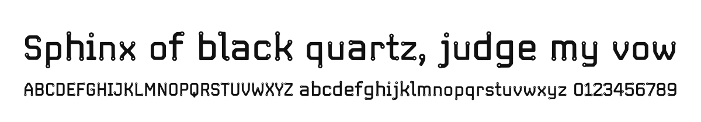

# Circuit font

**[Open in the gallery →](https://artifisio.github.io/fonts/circuit-font/)**

A full alphabet set vector font in a glowing cyberpunk style. Letters formed by glowing blue and magenta neon tubes integrated with micro-circuit board lines and metallic connectors. Dark background, crisp high-contrast glowing edges, futuristic sci-fi typography, high resolution

<p>
<a href="https://artifisio.github.io/fonts/circuit-font/"></a>
</p>

1 style · latin · OTF · WOFF2 · [OFL-1.1](https://openfontlicense.org)

## Install

```bash
npx artifisio add circuit-font --kind font
```

Or link the stylesheet straight from jsDelivr:

```html
<link rel="stylesheet" href="https://cdn.jsdelivr.net/gh/artifisio/fonts@main/sets/circuit-font/circuit-font.css" />
<style>body { font-family: 'Circuit font', sans-serif; }</style>
```

Styles: Regular (400).

---

Part of the [Artifisio fonts registry](../../README.md). Credit: Fonts by Artifisio (https://artifisio.com); `add` writes it to `ATTRIBUTION.md`. `meta.json` lists every file with its sha256.
